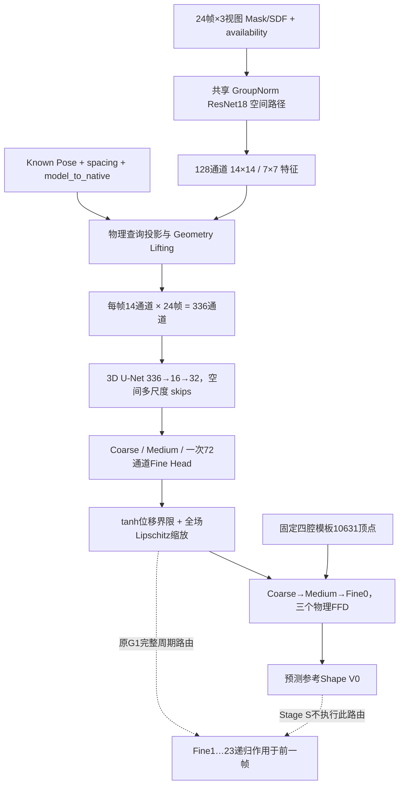

# HeartSSM 项目状态、研究证据与开发交接

审计日期：**2026-10-16，Asia/Shanghai**。工作区：`/mnt/nas1/disk07/yilong/HeartSSM`。本次为只读科研审计：没有训练、模型前向、Oracle、TTO、新几何认证、测试执行或算法修复；只读取源码/现有资产，安全读取三个 Checkpoint，核验选定哈希、统计已有指标，并新建本报告及审计证据目录。原先没有同名文件。

> **一分钟结论：最终目标是从稀疏 A2C/A3C/A4C Mask/SDF、已声明的采集几何与周期时间，直接预测患者特异的固定拓扑四腔 24 帧 Mesh，兼顾逐切面精度、三维解剖、运动和连续几何。当前尚无通过全部要求的模型。旧网络有真实完整周期 VAL100 结果；新 Geometry-aware S1 完成 TRAIN800/32,000 更新，但参考 Shape 尾部仍不合格。当前优先修复 Shape，尤其 A4C/RA、RV；不能用平均 Dice、latent 重建或 Motion 补偿替代它。**

本轮审计结论优先于旧交接文档中的“当前”“尚未运行”等相对表述；历史协议及结果本身保持原样。此报告不授权下一位代理自行启动正式 1K、10K 或真实 TTO。

## 1. 如何阅读与维护：事实、范围和证据级别

- **F：本次直接核对**：当前源码、Git、manifest 元数据、选定 Checkpoint 哈希/元数据、已有逐 Cell/更新日志的轻量重统计。
- **R：已有实验报告/日志支持**：未在本轮重跑训练、前向或几何。记录原预算、样本和版本，保留科学限制。
- **H：假设/建议**：尚未由因果消融或泛化验证；不得改写为已解决。
- **D：外部历史文档记载**：与当前 HeartSSM 不同仓库；已阅读文档，但未逐项重算其患者或 population 结果。

本轮机器可读证据在 [审计目录](outputs/project_status_audit_20261016/)：`initial_state.json`、`remote_confirmation.json`、`host_processes.json`、`checkpoint_metadata.json`、`data_manifest_audit.json`、`native_stratified_statistics.json`、`S2_completed_results.json`、`S2_loss_activation_check.json`、`archive_and_checkpoint_verification.json`、`completed_experiment_inventory.json`、`source_symbol_index.json`、`existing_source_hashes.json`。这些是调查产物，不是新实验。

源码位置采用“文件 + 符号 + 行号”；完整符号索引包含起止行号和本轮源码哈希。后续源码变化后，以新版本索引定位，不应继续机械引用旧行号。重要实验必须优先读其 `protocol.json`、`source/`、`completed.json`/`training_status.json`、评价明细与 Checkpoint；目录名和聊天描述不是完成证据。

## 2. 当前源码、Git 与运行状态

### 2.1 已提交与本地开发必须分开

| 项目 | 本次核对结果 | 证据 |
|---|---|---|
| 当前分支 / HEAD | `main` / `45db19b9b2ee790e4ab90e73032cd2802e1c836e` | `initial_state.json` |
| HEAD 提交时间 | 2026-10-15 21:03:25 +08:00 | `git log -1` |
| GitHub origin/main | 本轮首次经主机网络执行 `git ls-remote --heads origin main`，同为上述 HEAD；已提交提交差异为零 | `remote_confirmation.json`；另一次沙箱内重复查询网络失败单独保留在 `remote_ref.json`，不是远端变更证据 |
| 本地已跟踪修改 | 仅 `utils/geometry_joint_checks.py`，+27/-2 行 | `initial_state.json` 的完整 diff |
| 本地未跟踪代码 | **155 文件：119 scripts、33 tests、2 net、1 utils** | 完整列表在 `initial_state.json`，不能仅靠 GitHub 恢复 |
| 重要未跟踪模型 | `net/latent_heart_prior.py`、`net/conditional_latent_refinement.py` | 源码、对应协议/检查点 |
| 文档和结果的 Git 可见性 | `.gitignore` 忽略 `outputs/`、`docs/*`、数据、bundle、真实数据及 PDF；已有许多交接、快照、图表仅在服务器 | [.gitignore](.gitignore) |
| 活动作业 | 审计开始未发现 HeartSSM 训练/实验 Python 进程；其他 EchoGSF supervisor 属无关任务，未干预 | `host_processes.json`；不是“所有 GPU 空闲”的声明 |

本地几何修改为显式证书分派：默认仍用 `independent-global-columns-v1`；另加 **仅参考帧** Bernstein Frobenius 证书、alpha 合同、float64 复查及位移限幅。它不是全项目自动采用的新默认，也不是允许给 24 帧输出改个标志就通过。位置：[utils/geometry_joint_checks.py](utils/geometry_joint_checks.py)，`validate_prediction` L65，分派约 L91；依赖未跟踪的 `utils/bernstein_certificate.py`。本轮没有修改这两者。

### 2.2 关键提交链与实际意义

| 日期 | Commit | 作用；不能推断的事情 |
|---|---|---|
| 10-10 | `0329083`、`15279ed` | 数据验证、物理 B-spline/神经 Loss；不代表模型精度合格 |
| 10-10 | `788852f`、`082dd41`、`8d03647` | Direct residual、1K 数据/训练与长训练恢复；旧网络主线 |
| 10-12 | `1999287`、`a7e8a0c` | 区域运动诊断、淘汰旧 Known-Pose/latent 旁路；以现有代码和快照区分版本 |
| 10-12 | `4b4f7e9` | Reference Spatial Attention/Fusion；已实现不等于研究收益成立 |
| 10-13 | `878fa4b` | Dynamic Spatial Conditioning、冻结范围；该研究最终 FAIL |
| 10-13 | `80b4b45` | 独立 Geometry-aware G1：物理 Lifting、3D U-Net、Joint FFD |
| 10-14 | `c31727a` | G2 局部时序、支持感知融合、四腔几何/运动评价；不等于完成多 seed 消融 |
| 10-14 | `3dee4e0` | 修复 CUDA 浮点 ceil 导致的 CNN 特征池化中心错误 |
| 10-15 | `e7b0eb1` | Stage S 参考 Shape 路由；不是 Motion 已训练 |
| 10-15 | `45db19b` | S2 refinement、Native/Paired Slice 工具、患者 Oracle、缓存/测试等 |
| 本地未提交 | Goal05-R 大量脚本及两种 latent | 属开发实验资产；没有新的正式精度通过模型 |

**工程风险**：许多一次性脚本和文档处于忽略/未跟踪状态，部分旧 A3/A4 审核脚本已按过去的清理要求删除，报告还存在。现在不能擅自清理或替它们重新实现数学算子。下一次版本整理应先做资产清单、来源索引和必要归档，再经独立授权提交源码/文档；不要提交 NPZ、Checkpoint、缓存或运行时目录。

## 3. 数据、坐标、生成与评价合同

### 3.1 数据来源：SSM 提议不等于最终 GT 的 latent

源资产来自 `CardiacModel_v1.1.zip`，原始动态 SSM 用共同 16 维系数生成源 10 相位提议；经过明确线性周期重采样，保存 24 个独立时刻加首帧重复端点。`safe_local` 对每腔拟合随时间的正定粗仿射，用跨时间共享的逐顶点权重衰减不安全残差，最终保存真实 `vertices`，同时保留 `proposal_coefficients`、`deformation_weights`、`coarse_affine` 等来源信息。

因此：**生成提议系数只是来源记录，不能用 SSM16 重建替代安全修正后的 GT；也不能要求当前网络预测一个固定 SSM16 瓶颈。** 现网络学习的是观察条件到 Mesh/FFD 的共享先验，并非“恢复原生成系数”。[bundle 数据审核结论](synthetic_bundle_20261009/outputs/synthetic_audit_20261009/审核结论.txt)、[bundle README](synthetic_bundle_20261009/README.txt)、[asset.json](synthesis_data/original_ssm_v1/asset.json)。

### 3.2 固定身份

| 身份 | 值 |
|---|---|
| 活动 1K split | `synthesis_data/anatomical_per_sample_production1000_neural_splits_v1/{train,validation,test}.json` |
| 计数 / 划分单位 | TRAIN800 / VAL100 / TEST100；整例全部相位和视图一起划分，seed2026 的坐标身份哈希排序 |
| TRAIN manifest SHA256 | `c3c0c1e021f0cf5c4f734f1588ea722e908c69ba0a8c2241c7f78e3d54a0e990` |
| VAL manifest SHA256 | `5f96244274a9556654bd6506ad924880bb6668ac065d8d2e032bdc1d9715913d` |
| TEST manifest SHA256 | `1bbbbc67f530824c18848305e9fae38d57e712b00006427e98678a4b333f78f3` |
| 资产 SHA256 | `29a44d5682a338f2ba52ccdbee21ab831c213b15546e73ce114f185d300cced5` |
| 模板文件 | `synthetic_bundle_20261009/outputs/s1_repository_cleanup/initialization.pth` |
| 模板文件 SHA256 | `8b3a6a0f443df42ee2b8338df9656970963eb86496ad9784753b5620aa4dbd46` |
| 拓扑/模板 digest | `fce0a72d94ec13f7fd57e51027065275c2b1168e78966ec0e8bcd032480fe781`；不同于文件字节哈希 |
| 中心化单位 | `norm_to_mm = 89.48828125`；物理坐标为保存归一化顶点乘该尺度，中心另存，不再次叠加 |
| 顶点数及范围 | 10,631；LV `[0,4038)`、LA `[4038,5337)`、RV `[5337,9151)`、RA `[9151,10631)` |
| 每腔三角面数 | LV 8072、LA 2594、RV 7624、RA 2956，固定对应和局部索引 |

本轮核对 split 内无坐标重复、split 间无整例身份交叉；1000 个 NPZ/QC 路径均存在。**没有本轮全量重哈希 NPZ/QC，也没有读取 TEST payload 或新算 TEST 性能。** 历史 reader 会验证 source/QC/coordinate/topology 哈希。[本轮 manifest 审计](outputs/project_status_audit_20261016/data_manifest_audit.json)、[data/synthetic_4d.py](data/synthetic_4d.py) `Synthetic4DDataset._read_case` L198。

**TEST 的边界不能虚构**：当前三个 manifest 彼此不重叠，但 `derivation.json` 明写它是 diagnostic holdout，旧 pilot 900/100 可能已使用其中病例。当前 Goal04/05 没用 TEST 调参，不等于可以证明全研究历史从未接触该集合。未来正式评估前须核对历史暴露，并明确最终 holdout 的可信边界，不能改写旧划分使其看起来“从未用过”。

已有独立 10K 数据 manifest 为 TRAIN8000 / VAL1000 / TEST1000；文件存在不代表本模型具备 10K 启动资格。其 `population_diversity_validated=false`，人群/病理覆盖未认证。本轮只核对这批清单元数据，不重新认证 10K 或访问其 TEST 数据。

### 3.3 从 NPZ 到网络输入

1. 原始 NPZ：`vertices float32[25,10631,3]`、`masks uint8[25,3,4,Hn,Wn]`（当前源为 224 方格）、`probe_R[25,3,3,3]`、`probe_t/probe_s[25,3,3]`；端点的顶点、Mask、Pose 必须逐元素等于首帧。
2. reader 验证再去掉 f24，返回 `vertices_gt[B,24,N,3]` 物理 mm、原始 `native_masks`、Pose、标注可用性、phase `0,...,23/24` 和来源哈希。
3. **Frame0 是源周期参考标记，不是每腔 ED，更不是所有患者容积最大帧。** bundle 审核中 RV 有 433/1000 例 f0 比周期峰值低超过 1%；房室不能共用一套 ED/ES 假设。
4. MaskTransform 在固定物理 FOV 下作每视图统一逆最近邻变换，得到 224 模型格；保存 `model_to_native`。FOV 为 A2C 231.902、A3C 226.07、A4C 209.037 mm，不按患者/腔室 bbox 单独缩放、不悄悄翻转。
5. SDF 为 `EDT(outside)-EDT(inside)`，内负外正，使用各向异性 mm 间距，clip 15mm；活动配置不先归一化，CNN 内再除 15。Native SDF 在切片训练需要时单独按原格建立；不能把 model SDF 当 Native SDF。
6. A2C/A3C 只标注 LV/LA，A4C 标注四腔，**每相位 8 个有效 Cell，每患者完整周期 192 个**。未标注右心是不可用条件，不是零面积负标签。Mask、SDF、availability flags 同时参与编码/监督掩码。

源探头根据完整 GT 周期搜索，合成实验使用理想 Known Pose；这不是已经证明真实超声能提供同等准确的 Pose。A3C 多数样本并未切到生成器主动脉代理，只能稳妥称为第三个左心切面，不能直接宣传为临床标准 LVOT/主动脉可见三腔视图。源连续证书主要逐腔，不是完整四腔血池互斥认证。[configs/synthetic_data_1k.yaml](configs/synthetic_data_1k.yaml) L4、L18；[data/mask_transform.py](data/mask_transform.py) L47、L115。

### 3.4 Native Exact 的唯一口径与安全范围

`utils/slice_evaluation.py::section_mask` L20 固定原始 `trimesh.mesh.section + cv2.fillPoly` 语义；生成 core SHA 为 `4bd081a41efeed061959df89752e9afa79e7bb82c39833af128d7ad1ce4182b5`。`render_source_slice` L62 只把 mm 顶点转回源坐标，用原 Pose、原图尺寸渲染，直接比较保存 Native Mask，**没有图像配准或 model-grid 重采样**。

后来的 bundle topological-endpoint renderer 与这批标签可能差像素，不能因为名字更新就替换。GT 回绘必须逐像素匹配目标；缓存只复用身份一致的 GT 参考，预测指标必须重算。bundle 中 candidate939 的早期 ED 修复/17 像素记录属于另一历史标签入口，不能据此擅改 HeartSSM 当前标签；本轮核对的 S1 VAL100 和旧 Goal02 均报告当前活动 Native 目标零像素不一致。

几何分四层，不能把一个 PASS 通用到其他层：

- 控制场有限值/物理支持域/位移界限/全域 spline 导数上界；
- 输出离散三角面退化、自交和固定源 AV-cap 跨腔策略；
- 空间组合 Jacobian 的有限采样；
- 相邻时相及 23→0 的连续中间路径认证。

`.45` 的单射控制证书约束连续 spline 映射，不自动保证顶点直线连成的全部三角面、跨腔关系或全部时间插值合法。自交检测还排除共享顶点邻面，不能声称覆盖所有邻面额外重叠。固定源 AV cap 容许特定 LV–LA/RV–RA 支持区接触，既不能把所有接触都叫非法，也不能把所有重叠都豁免。[utils/geometry_joint_checks.py](utils/geometry_joint_checks.py) L16、L47、L65；[utils/geometry_pair_policy.py](utils/geometry_pair_policy.py) L19、L33；[utils/geometry_v2_checks.py](utils/geometry_v2_checks.py) L99、L121。

## 4. 当前网络结构与真实数据流

### 4.1 三条模型家族，不能混用结构或成绩

| 家族 | 实际入口/主要实现 | 状态 |
|---|---|---|
| 原始体数据 HeartSSM/FFDNet | `heartssm_train.py`、`train_ffd.py`、`net/ffdnet.py` | 历史体数据方法，保留；不是当前稀疏二维训练入口 |
| 旧 NeuralFFDNet | `train_neural_ffd.py` → `MultiViewTemporalEncoder` → latent/FiLM/区域 Shape、Motion → 物理 FFD | 已有 1K 全周期 VAL100 基线；旧 global z_shape64/z_motion32，不是新 S1 的直接结构 |
| Geometry-aware G1 / Stage S | `train_geometry_heartffdnet.py` / `train_staged_heartffd.py` → `GeometrySpatialEncoder` → 物理 Lifting → 3D U-Net → Joint heads | S1 正式参考 Shape 基线；活动问题诊断主要从它出发 |
| G2 / 本地 Goal05 候选 | `net/geometry_heartffdnet_v2.py`；`scripts/goal05r_*candidate.py`；两种本地 latent | 独立实验分支，分别有诊断结果；没有通过泛化/全门槛的替代模型 |

### 4.2 S1 前向张量与物理语义

| 模块 | 输入 → 输出；当前调用与梯度 |
|---|---|
| `GeometrySpatialEncoder` L8/L23 | Mask/SDF `[B,24,3,4,224,224]` 与可用性；每视图拼接四类 Mask、四类 SDF、四类 flags 成 12 通道；展平 `B×24×3` 共享 CNN。输出 `[B,24,3,128,14,14]` / `[B,24,3,128,7,7]`。S1 训练参与反传，GroupNorm 无批均值依赖。 |
| `MultiViewTemporalEncoder.spatial_features` L92 | 复用 stem、layer1/2/3、projections；layer2/3 原始 stride8/16，再 adaptive pool 到14/7。S1 **不调用**该类的视图 attention、temporal Transformer、shape/motion latent heads；这些属于旧网络。 |
| `project_physical_points` L15 | 物理查询 `[18432,3]`，行向量 `q=(X/norm_to_mm-t)@R`；源像素中心 `W/2,H/2`，经 `model_to_native` 逆变换得到模型像素。只读观察几何，不读 GT Mesh。 |
| `feature_sampling_grid` L56 | 反解 CNN receptive-center 和 adaptive-bin 中心；224 输入的中心为 `4+16j`、`8+32j`。已修复 CUDA 浮点 ceil 偏移，不应改回按整幅 resize 的假设。 |
| `GeometryFeatureLifting.forward` L91 | 两尺度各 `Conv2d128→4`，采样到细控制格 `[24,24,32]`；可用视图按 `exp(-.5*(distance/8)^2)` 融合，超过24mm或FOV外无支持。输出两组4特征 + support1 + nearest1 + chamber_support4 = **14 通道/相位**。 |
| 多视图融合限制 | 当前几何权重主要按 view 是否有任意有效腔、距离/FOV；混合 CNN 特征没有逐腔独立权重。四个 chamber_support 是元数据，不能当成逐腔独立编码已完成；但尚无因果证据证明换融合即可修好右心。 |
| `GeometrySpatialUNet.forward` L38 | `[B,24,14,24,24,32]` 展平为 `[B,336,24,24,32]`，首卷积336→16，再32通道 Fine；下采样 Medium `[12,12,16]`、Coarse `[6,6,8]`；三维 skips + trilinear 上采样输出三尺度32通道特征。时间在这里作为有序通道混合，不是独立的时间卷积或显式每帧局部查询。 |
| `JointFFDHeads.forward` L84 | Coarse/Medium 各3通道，Fine **一次**72通道解码为 `[B,24,24,24,32,3]`（时间×Gx×Gy×Gz×XYZ）。Fine0 界限12mm，Fine1–23各2mm；不是每腔独立网络。 |
| `_bound` L78 / `control_lipschitz_bound` L52 | `limit*tanh(raw/limit)` 后，用三个方向最大邻控制差/spacing 的 Frobenius 上界，全场乘 `min(1,.45/bound)`。这是全场耦合缩放；不是逐顶点自由位移，也不是每个点欧氏位移都≤2mm（2mm是控制分量界限）。 |
| `_deform` L158 / `bspline_ffd_physical` L33 | 对当前顶点查询64个三次 cardinal B-spline 支持控制点，返回 mm 位移；梯度进入控制场和查询顶点。参考应用 Coarse→Medium→Fine0；动态是 `Vt=FFD(Vt-1,Fine_t)`，不能每次回模板。 |
| `StagedHeartFFDNet.reference_output` L11 | 保留原 G1 参数键和72通道 Head，只留 Fine0，输出 `vertices_ref[B,N,3]`、`vertices_4d[B,1,N,3]`。共享 CNN/Lifting/U-Net/参考三头可训练；Fine1–23 对应输出行在 S1 中没有有效更新。 |
| `freeze_reference` L42 / `predict_motion` L57 | 原 Stage S 将全部参考参数及 evaluation buffer 冻结；原 `predict_motion()` 故意抛 `NotImplementedError`。这是阶段合同，不是整个工作区都没实现 Motion。 |

[核心源码](net/geometry_heartffdnet.py)、[空间编码器](net/geometry_spatial_encoder.py)、[Lifting](net/geometry_lifting.py)、[物理FFD](utils/ffd_physical.py)、[Stage S](net/staged_heartffdnet.py)。控制格物理域为 `[-120,-110,-110]` 到 `[120,110,110]` mm；`spacing=(upper-lower)/(G-3)`，`origin=lower-spacing`，支持节点是格的一部分，不采用旧 `FFDNet.forward()` 的 padding 和 `batch[0]` 行为。G1 只是复用该类的层/heads，前向使用新的批量物理适配器。

**潜在瓶颈的定位边界**：128→4、336→16、距离融合、全场缩放都是真实结构事实，但维度小或约束频繁活跃不等于已证明根因。已有增宽/旁路/证书变体的结果见第7、8节，不能再把它们写成从未尝试的万能建议。

### 4.3 本地 Motion 与两种 latent 的实现位置

- `scripts/goal05r_motion_candidate.py::IndependentMotionStage` L34：冻结全部 S1，新增独立69输出 Head（59,685 参数），缓存经身份核验的 S1 Fine feature；23增量均有梯度。`predict_motion` L157 已实现。此家族没有共享权重更新污染 V0；只做过单 TRAIN813 的拟合/干预，非 VAL100 Motion 先验。
- `scripts/goal05r_temporal_motion_candidate.py::PhaseConditionedMotion` L37：共享相位 Head 的小候选；同预算结果更差，未晋级。
- `net/latent_heart_prior.py::LatentHeartFFDPrior` L19：GT Shape/Motion posterior 与 observation latent heads、共享 FFD decoder；实际只有 GT-posterior Shape 重建训练，observation heads 未训练。不是已经学会二维条件推理的先验，也不是已经验证可采样的 VAE。
- `net/conditional_latent_refinement.py::ConditionalLatentHeartFFD` L35：冻结原 S1，观察 Fine feature 经池化→64D Shape code→128 trunk→三原始控制格残差；readout零初始化并重新施加原界限，初始化实际坐标差 `7.629e-6mm`。新增8,300,448个 Shape 参数；不应包装成轻量修补。独立 Motion code64+四阶 sin/cos 相位潜势差分，23场递推，**未完成真实 Motion 训练/泛化**。
- 周期控制潜势不证明递归 Mesh 闭合；f23是23/24时刻，不应强迫它等于f0。闭合验收针对23→0这一步的真实运动和连续路径。

## 5. 训练流程、激活 Loss、冻结和 Checkpoint

### 5.1 必须分开的 Stage 与同名 A/B/C

| 名称 | 真实优化变量 / 初始化 | 实际目标及范围 | 已运行情况 |
|---|---|---|---|
| 旧 Neural Shape/Motion/Joint | 神经网络共享参数，旧 long config；Motion阶段参考未完全冻结 | Shape、相对Motion、闭环velocity、volume、edge/lap/normal/control；Joint再加2D slice | 旧1K到已保存epoch162/step129600；不能把计划180轮当已跑满 |
| 新 Stage S / S1 | G1随机初始化，参考路由全部有效模块 | `reference_loss` 的 `stage='shape'`：shape1、edge.05、laplacian.05、normal.01、control.001 | TRAIN800，40轮/32000更新完成；输入24相位，目标仅frame0 |
| **S2 A** | 由固定32000步S1初始化的网络继续训练 | 原完整3D Shape；无2D slice | 有4800更新与VAL100完整结果 |
| **S2 B** | 同S1、同预算网络 | 3D + Binary Native **cell_mean** | 有4800更新；2D实际参与每一步 |
| **S2 C** | 同S1、同预算网络 | 3D + Binary Native **chamber_mean** | 有4800更新；不是Paired Soft |
| **Goal05 小队列 A/B/C/D** | 同S1；TRAIN32，512更新，VAL4 | A=3D；B=Binary cell；C=Binary chamber；**D=Paired Soft cell** | 全部完成，不等于正式VAL100；无候选通过 |
| **患者 Oracle A/B** | 网络冻结，单患者三尺度 raw controls，自S1预测出发 | A=Native2D+ detached S1几何先验；B=A+完整GT对应顶点Huber1 | 选定VAL233/306/848各1000控制更新；非网络训练 |
| 本地独立 Motion | S1全冻结，新独立head；可指定GT参考仅作诊断 | 原相对/绝对Huber及独立实验增项；实际版本看protocol | 单TRAIN813；无Motion泛化验收 |

**不能直接把 Slice 加到 `NeuralFFDLoss(stage='shape')` 就认为有效**：该函数 L127附近明确把 shape stage 的 motion/velocity/volume/slice 权重设0。S2正确接法在 `utils/reference_refinement.py::refinement_objective` L112，外部显式相加 `shape_weight*shape_total + slice_weight*slice_total`。Goal05 probe 在 `scripts/run_goal05r_shape_probe.py` L496 也是外部相加。旧 `train_neural_ffd.py::compute_objective` L284 只在 Joint构造slice，不应据配置里slice=.5断言Shape阶段使用2D监督。

### 5.2 损失的数学与梯度

完整3D shape 对各顶点 XYZ smooth-L1（beta1mm），先腔内平均，再四腔等权；包含GT edge/Laplacian/normal监督及控制平滑。没有用GT替换预测输入，也不是仅保持均值模板的形状先验。[utils/neural_ffd_losses.py](utils/neural_ffd_losses.py) `chamber_mean` L14、`_paired_huber` L59、`forward` L68。

Binary native surrogate 是连续切面距离→宽度sigma的logit/sigmoid，优化soft Dice+BCE+.1边界等组合；它并不等于原生fillPoly Hard Dice。Paired Soft 用同一可微切面算子产生 detached GT soft target，平方分母Dice与Bernoulli KL在相同几何达到零差/零梯度；这改善GT驻点性质，**不保证预测排序或网络泛化一定改善**。[utils/slice_supervision.py](utils/slice_supervision.py) `_terms` L224、`_reduce` L242、`_grid` L250、`forward` L262。

S2公共lambda为 **2.1242689150749596**，由固定TRAIN前4例梯度校准，B/C共用；Native sigma1mm、stride前1600步为4、后3200步为2。校准首例B：slice参数梯度L2=.09223，3D=.84609，余弦=-.08983。表明slice可对实际网络参数反传；不等于其更新方向有利。

本轮逐行核对正式S2 A/B/C的14400条历史更新：各步1..4800连续；A的slice均为null，B/C的4800步slice均为正；`total=shape+lambda*slice`最大数值差<4.4e-8，六组有效模块末步梯度均非零。证据：[S2 loss激活核对](outputs/project_status_audit_20261016/S2_loss_activation_check.json)、[原TRAIN校准](outputs/goal04s/refinement_calibration_fast/calibration.json)。这排除了该组“2D只是记日志没参与总Loss”的说法。

### 5.3 选择、保存、恢复与版本风险

- S1按VAL参考顶点等病例/腔 pooled RMSE选择；32000步best/endpoint/latest历史报告为同一模型。Checkpoint通用外层`epoch=0`，实际40轮由step32000及协议/历史记录确定，不可把这个字段解释成没训练。只有best字节哈希在本轮独立重核，其他同一性依据原summary/身份记录，不伪称本轮全文件重哈希。
- S2先作轻量验证/tail shortlist，再对candidate和endpoint最多两个不同状态做完整VAL100；`refinement_guard` L175要求3D/Unknown/几何不退化、原生尾部/计数等护栏，`tail_rank` L201排序；三臂`promotion.json`均false。
- Goal05 probe固定endpoint，不以困难VAL选择训练预算；但反复使用VAL4本身使其成为开发集，不能称全新独立验证。
- 原子保存模型、Adam、CPU/CUDA/Python/NumPy RNG、sample_offset、config/data/geometry/source/runtime；逐步LR/病例顺序必须与原协议一致。
- 旧Neural checkpoint键为`model/optimizer/rng`；G1/S1为`model_state/optimizer_state/rng_state`；架构reader不能互换。S1外层architecture仍为G1，必须看`runtime.stage_contract='goal04s-reference-only-v1'`，不能用G1 forward误跑未训练69通道。
- 当前源码自动枚举net/utils/data等哈希；新增本地文件或几何检查变更可能使历史严格resume/evaluate拒绝。`load_stage1_initialization` L207是明确的新stage迁移：核验固定S1文件及其42份source快照、只允许指定编排/监督源变化；它不是可随意放宽resume的入口。
- 零/均匀控制场的原始bound含`sqrt(0)`自动微分风险；新候选的`bound_with_certificate`（`scripts/goal05r_bernstein_candidate.py` L23）及V2的`bound_control_field`用inactive分支的精确tanh导数处理，保留前向界限。不能把这项局部处理说成原`JointFFDHeads._bound`已全局改写，未来中性零初始化必须验证有限梯度。
- 新 posterior prior 的 Motion读取曾因 `TorchVersion` str子类元数据被`weights_only=True`拒绝，发生在训练前。新 conditional writer 用JSON primitives避免该类错误；**旧prior文件/reader没有被修好**。不可用`weights_only=False`、换头标签或关闭身份检查冒充修复。[两个reader](scripts/goal05r_latent_checkpoint.py) L31；[新reader](scripts/goal05r_conditional_checkpoint.py) L16/L46。
- CUDA下一步重放历史允许有记录的浮点容差，CPU fixture严格相等；不把GPU归约误差说成bitwise可复现。现有七/十三/130/增量测试日志是各自版本证据，本轮没有跑测试。

## 6. 已完成工作时间线

同一天Goal05实验按协议依赖排序；文件mtime不当作启动时间。以下“完成”均须结合所列范围，不是全目标通过。

| 时间/路线 | 实际工作与结果 | 状态和权威入口 |
|---|---|---|
| 9月 EchoGSF / 患者TTO（外部仓库） | 固定拓扑、二维拟合、共享患者探头、静态/连续CCD与穿透恢复。高Dice可伴跨腔穿透、运动接缝和Unknown异常 | **D**，历史文档见第10节；不等于当前HeartSSM真实TTO成功 |
| 10-05/06 外部 Direct-GT Motion population | 文档记载900/100、7200更新，相对Motion改善45.9%，但物理GT有效90例 raw continuous PASS从control47/90变0/90，未晋级 | **D**，外部《合成预训练阶段总结与阻塞分析_20261005.md》；不与当前S2混用 |
| 10-08/09 数据审核与bundle | 1K开发源、10K独立生产源、安全局部修正、Native/连续证书边界、标签/视图语义限制；生成来源归档 | **R**，`synthetic_bundle_20261009/outputs/synthetic_audit_20261009/` |
| 10-10起 旧Neural 1K长训 | TRAIN800、Shape30/Motion30/Joint计划120轮；已有checkpoint到epoch162/129600，VAL100全周期 | 有可信基线；**计划180轮未证明完成**。`outputs/neural_ffd_1k_long_20261010_225918/` |
| Goal01 | Reference Spatial Fusion，成熟checkpoint上两臂各200 joint更新、VAL32 | 微小变化、主要配对CI跨零，未建立重建收益；`outputs/audit_result/goal01_spatial_fusion/` |
| Goal02 | 冻结旧best_joint完整VAL100，19200cells、3D/运动/几何及Shape/Motion交换 | 确认旧严重尾部主要Motion相关；`outputs/audit_result/goal02_full_val_diagnosis/final_diagnosis.md` |
| Goal03 | Dynamic Spatial Conditioner；A/B各800 activation+800正式对照，VAL100、固定latent/branch-off/方向审计 | 工程PASS、研究FAIL；A/B初始activation scope不同，不作单因子总比较。`outputs/audit_result/goal03_dynamic_spatial_conditioning/` |
| Geometry G1 | CNN→Known-Pose Lifting→3D U-Net→jointFFD，物理单位和局部空间信息更显式 | 架构/梯度/恢复已实现；不是精度全面胜过旧网络。`GEOMETRY_HEARTFFD.rst` |
| Goal04-A2 | 局部时序/SDF/视图融合/Fine skip的A0–A4、TRAIN16/VAL8、多seed协议 | 原正式144步消融表未执行，不能填上A3/A4其他实验的数值。`docs/goal04a2/ablation.md` |
| Goal04-A3 | 早期G2 checkpoint48更新（Shape32/Motion16），固定TRAIN16/VAL8，312个冻结周期干预 | 局部路径作用存在但患者特异净收益未确立；不是收敛比较。`docs/goal04a3/status.md` |
| Goal04-A4 | G1/G2/NoLocal同TRAIN4、seed2026、Shape128/Motion512/Joint128=768更新；定位并修复Lifting CUDA中心bug；修复版三模型重跑 | 修复后的G1 Motion1.063、G2 1.510、NoLocal1.430mm；G2不胜NoLocal，不能只靠加局部模块。`docs/goal04a4/status.md` |
| Goal04-S初期 | TRAIN4/VAL8，constant/cosine各768纯Shape；TRAIN约.93mm但VAL约5.2mm | 小样本拟合不等于泛化；无Motion晋级。`docs/goal04s/method_and_experiments.rst` |
| Goal04-S正式Shape | TRAIN800/VAL100、40轮/32000更新；缓存/预取/关闭activation重算的等价执行迁移 | 已完整结束；参考Shape安全与均值较好，但尾部不达标。`outputs/goal04s/train800_cosine40_complete_memoryfast/analysis/final_report.rst` |
| Goal04-S S2 | 同S1继续 A/B/C各4800，VAL100全量；另一次462步截断作业单列 | 完成的三臂均拒绝晋级，见第7节；不要把截断那次概括成所有S2未完成 |
| 10-15 Oracle A/B | VAL233/306/848，网络冻结、每臂每例1000 raw-control更新 | 同界限存在更好解；非泛化。原`oracle_ab_cuda7_20261015_202955/` |
| Goal05早期 | 单TRAIN813 A/D/SDF 256；TRAIN32/VAL4 A/B/C/D512；观察扰动、邻居/时间信息、控制/GT驻点审计 | 完成，未获联合泛化与尾部增益；`outputs/goal05r/diagnostic_report/` |
| Goal05后续Shape | Bernstein证书、冻结不同上游、Paired采样/宽度/校准/Cell focus、直接法向监督、全局bound光滑/梯度/参数化、early-CNN、skip索引对齐 | 多项有局部收益，但没有同时通过3D/Unknown/Native尾部；详见第8节与各report |
| Goal05 Motion | 独立69输出head、共享phase head、64→256预算、GT参考/控制Oracle、运动目标/递归/步长/连续安全/LS投影 | 通路已实现；只有单TRAIN813，未建成泛化Motion先验；不能说全项目Motion尚为stub |
| Goal05最近latent | template GT-posterior先验TRAIN32 Shape256；S1条件残差单TRAIN813256 | 前者条件head未训且序列加载失败；后者3D改善但尾部退化，均未晋级 |
| 本次审计 | Git/源码/数据/Checkpoint/旧明细/S2全量历史复核、文档整理 | **只读**；当前没有新训练、模型修复或候选晋级 |

旧Neural长训`epoch_history.jsonl`只有161条摘要，末条epoch162/129600；历史`train.log`更早截断，不应用某一份终端日志推定全部状态。Checkpoint及结构化摘要能证明已保存模型和对应评价；本轮未全量重放129600步的逐步连续性。

## 7. 关键定量结果与命名消歧

### 7.1 两个主网络基线：评价维度不同

| 指标 | 旧Neural best_joint，VAL100×24 | 新S1，VAL100×frame0 |
|---|---:|---:|
| 更新预算 | 129600（checkpoint epoch162） | 32000，40轮 |
| 参考Shape pooled RMSE mm | 0.630485 | 1.301303 |
| 全周期绝对RMSE / 相对Motion RMSE mm | 1.260013 / 1.141888 | **未运行新Motion，不能填值** |
| Native均值 | 0.978883 | 0.980346 |
| Native最低 / P01 / P05 | .906873 / .949183 / .961349 | .932166 / .948748 / .962627 |
| Cell≥.98 | 10371/19200，54.02% | 496/800，62% |
| Cell<.95 / 受影响患者 | 210 / 51 | 10 / 9 |
| 全部有效Cell≥.98患者 | 0/100（全周期） | 11/100（仅参考帧） |
| 参考三维ASSD / HD95 mm | 逐腔均值约.23–.30 / .56–.74；见Goal02表 | .499335 / 1.280259 |

旧网络**参考帧**Native均值 .988623、最低 .962474，比新S1参考更准确；但不同架构、控制族、安全约束和训练预算不能据此归因“Geometry Lifting本身更差”。旧模型没有同样的 `.45/12/2` 安全头合同，也不证明未来新Motion能力。旧Goal02中的平均网格RMSE1.1971与pooled RMSE1.2600口径不同，禁止替换。

本轮独立核验两份主Checkpoint的SHA及step，并从旧19200行CSV与新800cells重算表中Native数值。[本轮统计](outputs/project_status_audit_20261016/native_stratified_statistics.json)、[旧正式诊断](outputs/audit_result/goal02_full_val_diagnosis/final_diagnosis.md)、[新正式Shape报告](outputs/goal04s/train800_cosine40_complete_memoryfast/analysis/final_report.rst)。

### 7.2 尾部在哪：患者、时相、视图、腔室都要报告

旧模型：低于.95的210 cells中，RV87、RA77、LV30、LA16；A4C177、A3C17、A2C16，**全部非参考时相**，f12有41个、f7有22个，完整24相位和100患者分布见统计JSON。最差源病例513/f12/A4C/RV=.906873。用GT Motion替换的诊断增益在203/210严重cells占主导；这些混合网格不一定属于原FFD可达/安全解，不能当可部署提升。

新S1：全部是phase0，10个<.95全部A4C，其中RA7、LA2、RV1；89/100患者至少一Cell<.98。完整视图计数为A2C150/200、A3C161/200、A4C185/400达标。仅同A4C公平比较：

| 腔室 | 达标/100 | 最低 / P05 Dice | 3D参考RMSE mm | 定义下Unknown顶点占比 |
|---|---:|---:|---:|---:|
| LV | 78 | .967511 / .972129 | 1.0363 | 1.13% |
| LA | 48 | .944576 / .961097 | 1.1333 | .79% |
| RV | 31 | .942250 / .960435 | 1.3357 | 41.23% |
| RA | 28 | .932166 / .948437 | 1.6221 | 25.72% |

RA/RV是重点，**LA也有明显尾部，不能只报右心后忽略它**。Dice最差为306/RA，三维对应误差最差是233/RA（RMSE3.993、P957.384mm），不是同一个“最差”。TRAIN32最低Dice为813/RA=.900528，说明严重残差在已见训练病例也存在，不能仅称泛化不足。TRAIN800只做过轻量顶点/容积，不能把TRAIN32全表面/Native最低值冒充TRAIN800最低值。

### 7.3 已完成的网络 S2：每臂4800，VAL100

统一起点S1、TRAIN800、seed2026、cosine1e-4→1e-5，阶段总步数另加于S1；下表固定endpoint，而非事后挑最好均值：

| 版本 | 参考RMSE mm | Unknown RMSE mm | Mean / Min Dice | P01 Dice | ≥.98 /800 | 原护栏 |
|---|---:|---:|---:|---:|---:|---|
| S1 | 1.301303 | 1.403538 | .980346 / .932166 | .948748 | 496 | 基线，仍未达精度目标 |
| S2 A，3D-only | 1.289548 | 1.387815 | .980499 / .932189 | .947904 | 504 | FAIL：最坏surface/Unknown、P01 |
| S2 B，3D+Binary cell | 1.292186 | 1.388454 | .980173 / .933300 | .949501 | 499 | FAIL：最坏surface/Unknown、容积、均值 |
| S2 C，3D+Binary chamber | 1.292375 | 1.388923 | .980243 / .931665 | .949215 | 500 | FAIL：最坏参考/Unknown、容积、均值、minimum |

每臂还评估过shortlisted candidate（A step800；B/C step2400），也都FAIL。完整数值、各Checkpoint SHA、失败项在[本轮S2结果](outputs/project_status_audit_20261016/S2_completed_results.json)，源为`outputs/goal04s/refine_abc_fast_cuda1_20261015_174308/{A,B,C}/`。本轮重核三个endpoint文件SHA与评价记录一致。**Geometry_safe=true不是accuracy通过，稍增计数也不能抵消尾部/Unknown退化。**

另一次`refine_abc_fast_20261015_180919/A`只有462/4800更新、`complete=false`、`time_limit.pth`，不计入完整S2对照。`configs/staged_heartffd_refine.yaml`头注仍称Draft、slice_weight=null是校准前配置；不能用它否定已有frozen protocol与4800步记录。

### 7.4 患者 Oracle：只在选定三例上成立

| 指标，233/306/848共24cells | Initial S1 | Oracle A：2D+S1先验 | Oracle B：A+3D GT |
|---|---:|---:|---:|
| Mean / Min Native Dice | .968058 / .932166 | .979727 / .968336 | .986818 / .962098 |
| ≥.98 /24 | 8 | 15 | 20 |
| 全部8cells达标患者 | 0/3 | 0/3 | 0/3 |
| 顶点RMSE mm | 2.2292 | 2.3878 | 1.0110 |
| ASSD / HD95 mm | .8453 / 2.1300 | .7229 / 1.8897 | .2913 / .9263 |
| Unknown RMSE mm | 2.2546 | 2.4686 | .7707 |

A改善表面和法向，却恶化对应/切向/Unknown，不能笼统写“表面全面毁坏”。B联合改善，但minimum仍低于.98。六次各1000尝试、50步审计block、120接受端点，失败则回滚controls与Adam；所有完整端点通过原结构门。B末200步仍改善约1.01%–1.51%，无全局最优/收敛证明。

A三例surrogate低于Hard Dice恰为1的GT，直接证明当前Binary代理排序失配；没有隔离sigma/stride/项组合各自贡献，也不证明GT在该受限FFD族内精确可达。原结果：[Oracle报告](outputs/goal04s/oracle_ab_cuda7_20261015_202955/final_report.rst)，runner `scripts/run_reference_oracle.py::fit_objective` L53。

Goal05后续B由保存raw-controls/Adam续至2000：顶点约.9790、min .96383、仍20/24；同预算Paired控制条件约.9752、min .96304、21/24。仍是GT辅助患者拟合，不是S2网络。见[续跑](outputs/goal05r/reference_continuation_report/report.rst)、[目标对照](outputs/goal05r/reference_objective_report/report.rst)。

### 7.5 本地独立 Motion：有实现、有单例更新，无泛化模型

| TRAIN813条件 | 已保留更新 | Relative / Absolute mm | Mean / Min Dice | ≥.98 /192 | 解释 |
|---|---:|---:|---:|---:|---|
| 独立joint head，预测V0 | 256 | 2.1547 / 2.2040 | .95747 / .88430 | 25 | 已见单病例；不是VAL |
| Shared phase head，预测V0 | 256 | 3.5632 / 3.6458 | .92254 / .77991 | 5 | 同预算更差 |
| raw-control GT-reference Oracle | 256 | 1.9566 / 1.9566 | .96354 / .84956 | 56 | 完整GT参考及患者拟合，不是条件推理 |

第一行幅度比LV .891、LA .939、RV .867、RA .815；右房缩幅最明显。关闭/增加法向、闭环velocity等项的64步试验没有形成可接受联合改进。保留场的原 `.45` bound未触发，不能靠证书放宽解释其现有残差。后续GT-assisted least-squares head-span投影虽然拟合了控制系数，仍有Mesh/Native误差与GT参考下几何失败；它不是网络学会预测Oracle。[运动预算报告](outputs/goal05r/motion_budget_report/report.rst)、[容量报告](outputs/goal05r/motion_capacity_report/report.rst)、[投影证书报告](outputs/goal05r/projected_motion_bound_report/report.rst)。

本地脚本中名为“Joint”的这些运动head族不等于已完成“解冻Shape+Motion”的受限Joint阶段。

## 8. 尝试过什么：可复用收益、失败与停止决定

下表是逻辑复盘，不为失败解释编造唯一原因。全部具体条件以对应协议为准；失败仅反驳该版本/预算，不证明所有同类方法不可能。

| 已做方案 | 可信结果 / 限制 | 当前决定与证据 |
|---|---|---|
| 旧Reference Spatial Attention | 200步/VAL32，RMSE和Dice变化约1e-6级、配对区间跨零；梯度/响应存在 | 不重复叠加修补；Goal01 `completion_audit.json`、`overall_comparison.json` |
| 旧Dynamic Spatial/FiLM路径 | Goal03 B relative1.13698对照A1.13730，仅约.00032mm；minimum .9065对照.9070，尾部未改善；RA/RV更新与残差方向余弦约.06 | 工程PASS、研究FAIL，停止原线；`validation_100.json`、`branch_alignment.json` |
| G2局部时序/SDF/融合/Fine skip | 修复版TRAIN4 G2 Motion1.510，比同head NoLocal1.430更差；固定权重关闭会变差不等于训练净收益 | 不重复用“有梯度/关掉变差”晋级；`docs/goal04a4/status.md` |
| S1训练多样性/预算 | TRAIN4 VAL约5.2mm到TRAIN800 VAL1.301mm，明显改善；末5轮仅.89%改善 | 已是有效基线建设；不能归因单个架构更优，也不盲目延长同LR |
| 当前Shape A/B/C/D目标对照 | TRAIN32×512，VAL4 A/B/C/D reference约2.0423/2.0436/2.0460/2.0398；min .92752/.92457/.92365/.92868；通过13/13/12/13个/32 | Paired/Chamber mean不自动修尾部；所有候选未通过。`train32_val4_abcd_512_v1/summary.json` |
| 原始224 SDF skip | VAL4与A几乎相同或尾部更差；没有跨患者联合收益 | 不再以同样末端SDF旁路重做；`train32_val4_sdf_A_512_v1/completed.json` |
| Bernstein全域证书 | 单813 A256约1.1576→.8191mm、Unknown1.3547→.9808、min .9355→.96545，5→6cells；同.45界限的证书更紧 | 有效局部机制，但VAL4虽3D/Unknown改善，12cells少于S1的15，未晋级；`certificate_report/` |
| Paired full-grid / sigma.5 /TRAIN梯度校准/Cell focus | 分别有目标/采样上的局部改变，无完整联合护栏收益 | 不继续sigma/stride/weight扫参；`paired_variants_report/`、`cell_focus_report.rst` |
| 冻结heads/encoder/lifting、lowLR、coverage控制 | 部分训练拟合或稳定性变化，未建立VAL尾部优势 | 不能把冻结策略作为已修根因；`decoder_scope_report/`、`head_only_shape_report.rst` |
| 法向位置监督 | 单813 min .96545→.97269、6→7cells；Unknown .98081→1.00451，越过+.02mm护栏 | 有尾部收益但联合FAIL；不得放宽护栏后追认成功。`observed_normal_report/` |
| 直接梯度/Adam方向投影分析 | 20状态fullShape与UnknownMSE梯度余弦均正，.115–.690；原Shape Adam一阶Unknown均下降 | 不支持“Huber饱和导致当前Shape梯度普遍反Unknown”解释；不启动无依据MSE/beta扫参。`shape_update_direction_report/` |
| calibrated残差 / smooth global envelope | calibrated单例min提升但达标数减少；smooth等未通过联合实际拟合 | 数学/一阶机制不等于有限步精度，停止各失败候选；对应`*_report/` |
| early layer1物理skip | +3328权重，单813 min .935515→.936416，仍5/8；纠正方向cos .33936→.33019 | branch确实被使用但尾部增益不足，拒绝；`early_feature_report/` |
| 两处3D skip j/2索引对齐 | 0新参数，单813 RMSE1.1576→1.3627、Unknown1.3547→1.6330、min .9355→.9292，5→4cells | 原假设失败；名义中心偏移18/9mm不是Mesh误差。`aligned_skip_report/` |
| Template GT-posterior latent | TRAIN32 Shape256，GT重建5.604→2.7865mm，仍不如S1同均值口径.9892；观察heads未训 | 非条件先验；Motion在加载时因TorchVersion失败，未训练。`latent_prior_train32_v1/` |
| S1条件latent残差 | 单813256，RMSE1.1576→1.1101、Unknown1.3547→1.2796，但min .9355→.9299、P01/P05退化，仍5/8 | 拒绝替代S1，未进TRAIN32或Motion；`conditional_latent_report/` |
| 安全局部控制投影preflight | 冻结813 Fine0，参考1.6064→1.4960、Unknown1.9328→1.7713；.45保留 | 仅对应误差preflight；无新Native/完整几何/网络拟合，不是可推广修复。`local_control_projection_v2/` |
| reference pair dual下界 | 233必要平衡RMSE下界约.1475mm；共享端点向量合并，保存witness | 是必要下界，不是可达上界或Dice极限；无需继续以证明替代模型进步。`reference_pair_dual_v1/` |
| 24相位观察干预 | TRAIN5 full24参考1.171/Unknown1.248，phase0-only6.724/6.677，重复参考4.045/3.843 | 当前S1利用周期观察；分布外干预不能证明3视图唯一可辨识。`observation_motion_limits_report/` |
| Motion步长/递归/投影诊断 | 原2mm步预算存在非零必要误差，但保留网络离下界尚远；反馈与局部误差可部分抵消；部分GT-assisted投影场bound确实过保守 | 不把全部Motion残差归咎递归爆炸或放宽界限；未获联合准确、安全的网络。相应Motion报告 |

完整35份可发现`completed.json`的路径及提取指标在[实验完成记录索引](outputs/project_status_audit_20261016/completed_experiment_inventory.json)。这不是所有历史作业的总数：有些用`results.json`/`run_status.json`，截断/失败的attempt也必须保留，不能因没有`completed.json`就默认为未运行。

## 9. 当前问题、根因确定程度与可执行修复方案

### 9.1 当前最重要的三个问题

1. **参考Shape Native尾部未达标**：不是“整体已经好，只缺Motion”；右心和部分LA在已见病例也失败。
2. **观察到局部控制的有效预测不足，目标与Native尾部不充分一致**：已知局部线索削弱、代理排序失配、平均3D/Unknown改善仍可恶化轮廓；尚未找到通过联合护栏的最小修复。
3. **独立Motion及完整周期安全/目标合同尚未建立可推广解**：有单例通路和运动改善，仍有幅度/方向/时序尾部及跨腔GT兼容性问题，无可接受新Shape/Motion/Joint模型。

### 9.2 Shape为什么不够好：哪些有证据，哪些没有

**已确认事实/机制**：

- 右心仅A4C，Unknown比例更高；完整3D监督是存在且腔均衡的。支持区只是一种距离/FOV定义，不是可辨识性证书。
- 233/306/848/931同A4C/phase0的2mm局部编辑、同步重建SDF，RA修改18–20像素、LV17–19像素。RA/LV响应L2比在stem为1.33–1.84、layer2为.032–.085、输出14图为.028–.045、128→4后约.028–.044；主要相对削弱已在CNN内部出现。RA位置A4C融合权重仍.783–.869，不能说“被另两视图完全平均掉”。
- 最终RA全腔位移响应仅约.00045–.00081mm，LV对应.0128–.0212mm。该差异支持编码/使用右房局部细节不足，但不是充分因果证明：四例有限、位置和通道不同、完整SDF扰动能量未严格配平；RV不能直接套用RA比值。
- Medium/Fine0在S1 VAL100均触及.45；全场缩放会耦合局部。但同界限Oracle明显更好，排除“.93已经是被证明的硬天花板”。
- Binary surrogate在GT仍有非零梯度且可排错序；Paired驻点正确不保证优化/Native排序/泛化正确；实际S2和Goal05对照没有解决尾部。
- 单例能进一步学到更好控制，TRAIN800/VAL100仍有相近量级残差；近平台不等于全局最优，不能单纯归因过拟合。

**尚未确认**：14/7分辨率是唯一瓶颈、128→4或336→16是主因、A4C融合必然错误、右心形态天然更复杂是主因、Pose/GT标签错误主导当前尾部、Huber饱和是唯一原因、latent/更大模型一定有效、所有Unknown GT都可由当前输入唯一恢复。整体配准、输入敏感度、梯度余弦和有限单例各只能回答部分问题。[右心分析](outputs/goal05r/right_heart_analysis/report.rst)、[feature controls](outputs/goal05r/feature_controls_v1/results.json)。

### 9.3 Motion、安全、生理与可达性

旧模型比新单例Motion更成熟，但旧VAL100严重尾部仍主要来自非参考相位：全局幅度比约.968，RV/RA约.958/.960，方向余弦约.91，不是“完全没有运动”，也不能靠统一放大消除局部错误。23→0预测步RMS1.4208mm、GT.8824、闭环步误差约.8758，动态接缝仍需专门评价。早期G2/48步的25%–44%幅度不能套用到这个成熟旧模型。

当前独立Motion256右心缩幅、方向与局部场仍不准。递归误差要分当前步控制错误、查询位置反馈和累积误差；已有结果不支持“一切都是漂移爆炸”。原2mm限制确有某些目标运动的必要误差下界，但这不证明保留网络已逼近可达极限。加入平滑前必须联合检查真实位移/速度、幅度、方向、容积曲线、心房极值时相、EF代理和归一化jerk；相位步指标不是秒级生理指标。

**确定的目标/安全合同冲突**：已有TRAIN800/VAL100 QC元数据证书主要是模板→frame0及piecewise-linear周期的逐腔检查。固定TRAIN5/VAL4实际复核，7/9全周期通过当前跨腔策略；TRAIN813的RV–RA、VAL233的LV–RV/RV–RA失败，原始float64与缓存相同事件，全部1728 Native GT cells逐像素一致。TRAIN813非cap最大深度约1.8797mm。九例frame0均安全。

因此不可能同时要求对这些完整GT周期零误差、又通过当前严格跨腔排斥策略；需要科学上明确目标与表示合同。**不能改GT、丢病例、重写QC身份或降低预测阈值来消除矛盾。本轮只记录；它不豁免Shape尾部。** 当前尚未全量审查其余891个TRAIN/VAL全周期跨腔目标，不能推测违例率。[GT兼容性报告](outputs/goal05r/GT_policy_report/report.rst)。

### 9.4 优先级问题表：下一次开发必须按单因子验证

以下均为**建议，不是已修复或本轮授权执行**。表中阈值若来自旧协议则保留；新标准须在未来试验前冻结，不能回写历史。

| 优先级 | 问题与证据 | 根因确定程度 | 建议修改及具体位置 | 最小验证与PASS/FAIL |
|---|---|---|---|---|
| P0-1 | S1 304/800不达.98；均值掩盖尾部 | 确定现象 | 复用`shape_tail_guard`，在未来统一trainer/evaluator选择入口接线；`train_staged_heartffd.main`、`reference_refinement.refinement_guard/tail_rank`、`run_goal05r_shape_probe.main` | 同一case/frame/view/chamber全分母；global/逐腔/患者最差min、P01/P05、severe/pass计数保护，3D/Unknown/安全独立必过；均值不能抵消。当前独立helper已有4项历史测试，但**未普遍接入所有runner**；其patient_worst是各患者最差值的分布护栏，尚非逐患者一一不退化检查 |
| P0-2 | Binary代理GT不驻点且排序失配 | 确定机制，主误差占比不明 | `MeshSliceSupervisor._terms/_reduce`，保留原Exact renderer；先复用已做paired/sigma/stride证据，不再做相同消融 | GT/邻域方向/真实NN参数更新与Native尾部共同验收。不能仅把Loss改成Paired就宣布解决 |
| P0-3 | 完整周期GT与固定跨腔规则有冲突 | 固定9例确定，整体率未知 | `geometry_pair_policy.SourceAVCapPolicy`与数据生成QC合同的科学版本设计；此轮不改文件 | 保留全部病例/原数据，写清可达目标、拒绝/风险策略、独立身份；新周期目标与预测安全一致后才启动完整Motion泛化 |
| P0-4 | prior TorchVersion导致安全读取失败 | 明确工程错误，旧reader未修 | 未来仅修改`goal05r_latent_checkpoint.save_latent_checkpoint`及训练runtime元数据，仿照JSON primitive新writer | CPU安全冷加载+下一步Adam/RNG/错误身份拒绝；不重训已完成Shape、不unsafe加载旧文件、不修改旧checkpoint |
| P1-1 | RA局部响应在CNN中显著削弱 | 有限干预支持，具体修复未知 | 优先`GeometrySpatialEncoder.forward`/复用`spatial_features`的腔室保持局部编码；必要时小型支持带局部control residual，复用原投影与FFD | 先TRAIN正常/困难控制的等能量、同物理局部扰动和GT纠正响应；再单case256与已有A256同预算比较；若方向/Native尾部不进步停止，不重复已失败generic SDF/early skip |
| P1-2 | 对应/Unknown下降仍可伤RA切面 | 确定trade-off，责任未孤立 | 若先验证loss方向问题，在现有3D+Native目标中做一个明确局部风险项；`reference_loss`外部联合入口；保持完整GT与其余cells | 固定TRAIN target/权重策略；实际有限Adam步同时下降局部边界与3D/Unknown；禁止重复已失败的标准梯度投影、MSE/beta扫描或事后放宽+.02mm护栏 |
| P1-3 | 全场缩放耦合 | 算法机制确定，accuracy贡献不完全确定 | `JointFFDHeads._bound`；仅在已有Bernstein/局部投影证据基础提出有完整证明的不同参数化 | 保留.45/12/2，float64独立证书+actual三角/Native/连续路径；同预算联合小队列有益才留。不要重新放宽阈值或仅做必要下界证明 |
| P1-4 | 小队列泛化与开发集反复使用 | 事实；净收益未成立 | 固定TRAIN32/VAL4仅作为诊断，随后锁定未调参确认与TRAIN800短程；配置/Checkpoint独立版本 | 同数据顺序、初始S1、loss、更新预算、seed；多seed患者配对CI及tail护栏；确认集不能一边看一边改预算 |
| P2-1 | 新Motion有通路但单例精度不足 | 确定 | 在`IndependentMotionStage.motion_from_context`基础隔离相位特异观察条件；不回旧FiLM大修补 | 冻结V0 bit-exact；23场有效梯度；方向/幅度/右心/Native/closure/continuous同时改善；先固定预算单例再队列，不把GT参考Oracle作部署成绩 |
| P2-2 | 时序目标与缩幅、房室相位 | 目标冲突风险，非统一主因 | Motion objective入口，逐项relative+absolute→velocity→volume/phase；四腔独立时相解释 | 使用真实GT项且记录参数梯度/冲突；不以低jerk单独PASS，不强迫四腔共同ED/ES |
| P3 | Shape/Motion补偿和连续Joint安全 | 已有交叉项/反事实证据 | 未来新受限Joint入口；原`predict_motion`stub不是直接解冻方案 | 完整周期Shape/relative/absolute/192cells全测，V0守护、23→0与中间CCD；任何几何失败都回退，不用abs误差掩盖分量差 |
| P0工程 | 脚本/身份分散与历史严格resume脆弱 | 确定资产风险 | 新实验注册清单、只读身份预检、共用已有trainer/FFD/render；未来整理而非现在删除 | 以source/manifest/checkpoint哈希复现一个已完成状态；冷加载先于GPU预算；只归档/索引，不消灭历史失败记录 |

## 10. 历史错误与永久避免清单

| # | 错误/风险 → 后果 | 如何发现、已采用方式 | 以后如何避免 / 未完成边界 |
|---|---|---|---|
| 1 | 平均Dice高→大量尾部失败被隐藏 | 旧210cells<.95，新S1仅62%过.98；已保存逐cell/tail表 | 每例/相位/视图/腔室报告minimum、P01/P05、失败计数、all-cell病例；helper未自动接入全部trainer；若要求逐患者最差值一一不退化，需另加明确匹配检查，不能冒充分布护栏已经做到 |
| 2 | 用Soft Dice验收→与原生Hard不一致 | Oracle GT排序、Goal02/05 loss审计 | Exact Native独立裁判，Soft只作训练代理；不改renderer追求好看 |
| 3 | Binary在GT有偏→优化远离精确匹配 | 三例GT梯度非零、A surrogate低于GT | Paired零驻点已实现，但历史网络无联合收益，不声称修复精度 |
| 4 | 3D/2D未实际联合→配置有权重却失效 | `stage='shape'`把slice置0；S2明确外加，两臂4800步实际核对 | 记录total恒等式与实际NN梯度，不仅看YAML；保留当前正确接法 |
| 5 | 强2D拟合→Unknown/对应恶化 | OracleA Unknown2.2546→2.4686 | 完整3D及Unknown护栏，不能以高Dice交换未观测结构 |
| 6 | Oracle当泛化→夸大网络能力 | runner只更新raw controls，选定VAL三例 | 明确输入/优化变量、患者拟合或网络更新、TRAIN/VAL范围 |
| 7 | 非零梯度/关断变差→误判局部模块有效 | Goal01/03、G2对NoLocal未见净收益 | 必须同预算对照、有限更新方向和真实tail收益 |
| 8 | 强平滑缩幅→轨迹看似稳定 | 早期G2/新Motion缩幅；旧模型并非同等缩幅 | jerk和幅度/方向/volume-phase联合；不默认平滑越大越好 |
| 9 | 逐帧安全→宣称连续安全 | 真实TTO后查26单腔碰撞区间；Goal05独立CCD | 保存相位与时相间路径分开认证，优化器步长CCD不能冒充生理时间CCD |
| 10 | 忽略23→0或强制V23=V0 | 旧闭环误差、TTO接缝；周期编码不等于Mesh闭合 | 24独立点、闭环差分，重复端点只存储去重，不误删真实闭环运动 |
| 11 | frame0=所有腔ED | 数据容积峰值偏移 | 使用relative_observed_cycle_time，四腔单独报告极值 |
| 12 | 未标注右心=空背景 | A2C/A3C有效性合同 | Mask/SDF/flags全链路一致，缺失不参与目标 |
| 13 | mm/像素/采样中心错误 | CUDA浮点ceil错移4/8模型像素 | `3dee4e0`整数bin修复；保留CPU/CUDA物理ramp、GT native parity；不能把bug修复必然等同精度提升 |
| 14 | Known Pose=真实可用Pose | 合成由全GT周期搜索；真实文件不提供同等精确Pose | 单独验证真实标定/估计及失败策略，禁止使用患者3DGT反推部署Pose |
| 15 | bound频繁触发就放宽 | Oracle/证书对照显示不是已证硬ceil | 不动.45/12/2；新证书须证明且完整accuracy/safety重审 |
| 16 | 反复补丁旧FiLM/Attention | Goal01/03有效响应却无尾部收益 | 旧路线停止；新假设须区别于已失败模块且预先写因果对照 |
| 17 | 为latent重引SSM16固定瓶颈 | 安全修正GT不再精确位于提议SSM中 | 以真实GT训练，latent维度由任务证据决定；不能仅压缩就称良好先验 |
| 18 | 跨架构/预算直接排名 | 旧129600、新S132000、G2早期48/768差异大 | 同预算、同初始化可比部分；保留训练成本/架构差异说明 |
| 19 | 仅保留最高均值checkpoint | 均值与最坏/Unknown冲突 | 保留initial/latest/endpoint/candidate及拒绝理由，尾部+3D/安全共同选择 |
| 20 | source/data/checkpoint不一致 | 旧G1/G2有旧网格快照；严格reader拒绝变化 | 读协议与source快照；显式新stage迁移而非strict=False/reheader；部分旧Neural缺逐文件履历须标限制 |
| 21 | 反复VAL难例调参或历史TEST已用 | VAL233/306/848长期开发；split derivation注明pilot暴露可能 | 不再称VAL4独立泛化；锁定后续确认，追溯holdout，不改旧split假装干净 |
| 22 | 更新renderer→历史Dice不可比 | 后版topological endpoint与旧merged endpoint差像素 | 固定原generator函数/hash/库版本；新renderer只能独立研究 |
| 23 | 改GT/manifest适应安全策略 | 当前9例GT中2例跨腔冲突 | 科学合同版本化；不删病例、不改标签/哈希，不把逐腔证书说成全心 |
| 24 | 计划=实现=实验=验收混淆 | A2空消融表、S2完整与截断同名、latent观察head未训 | 每条记录四种状态，优先completed/history/checkpoint，而非名称 |
| 25 | SSH/VS Code退出丢训练 | 存在多个time-limit/续跑链；具体断连原因未逐一核实 | 独立supervisor、原子checkpoint、明确sample offset、日志与TERM；不要声称所有中断都是SSH |
| 26 | Git提交大数据/ckpt/cache | 当前ignore保护，但文档也被忽略 | 提交前资产分类、check-ignore与大小审查；本次不commit/push |
| 27 | 删除测试/快照→无法复查 | A4历史清理98脚本/测试、70缓存有文档记录，部分原脚本不再存在 | 保留重要回归及source快照/失败日志；本轮不清理，不假称旧脚本可直接跑 |
| 28 | 重复trainer/render/FFD→科研资产混乱 | 本地119 scripts、多个v1/v2失败尝试 | 共用现有数学核心，新增只需版本化编排/报告，先索引后整合；不删证据、不复制一套新FFD |
| 29 | TorchVersion等非primitive元数据→安全恢复失败 | posterior prior Motion启动前失败日志保留 | 新writer已用primitive；旧writer待修，冷加载先于序列GPU训练 |
| 30 | GPU必须空闲/耗时异常还等待→浪费 | 已有free-memory选择、wall/progress watchdog，冻结上下游可缓存 | 足够free VRAM即可共享；明确预算/无进度阈值，仅处理本任务异常进程，不碰他人或外部supervisor |

外部EchoGSF事实边界：历史文档 `.../echo_gsf_4ch/docs/TTO_CURRENT_HANDOFF_20260915.md` 记载一例137/150观察Dice≥.98、但联合全部指标仅80/150、跨腔55/144失败；后续发现连续碰撞，原结果未升级PASS。分割EF接近报告的28例筛选队列存在选择偏倚。上述属于D级历史，不是当前17例真实数据的新网络TTO成绩；外部文档哈希/绝对路径已保存于`external_history_evidence.json`。

## 11. 下一项工作：最多三个可独立交给开发代理的任务

**本轮只提出，不执行。以下是后续诊断/小规模开发建议，不包含自动正式训练许可。**

### 任务1（首选）：使右心局部条件的修正真正改善 Shape 原生尾部

交给下一代理的范围：从固定S1和现有TRAIN5（376/112/620/604/813）及`feature_controls_v1`、`early_feature_report`出发，区分RA/LV扰动的**输入能量/位置差异**与CNN腔室信息衰减；复用已有产物，不重跑相同四例VAL perturbation或已失败generic SDF/layer1旁路。必要补证仅限事先固定的TRAIN局部干预，记录对应GT残差方向及实际有限步效果。

若证据支持腔室混合削弱，最小候选是**保留S1主体、腔室身份保持的浅层A4C Mask/SDF局部编码与有观察支持的局部控制残差**：它必须与已失败的混合layer1 skip有明确区别，不是再加一个global latent，不复制renderer/FFD。修改候选位置为`GeometrySpatialEncoder`及单独候选类，而非改历史S1文件语义；先精确定义一个结构因素，保留3D GT、原三尺度FFD/界限/Exact。

先跑未来预声明的单TRAIN813 256步，与已有A256控制同预算；必要时仅新增同预算控制，不依结果延长。过关才进固定TRAIN32/VAL4 512步，记录TRAIN32轻量/全部Native和固定TRAIN5完整3D/Unknown/几何，VAL4全部cells。旧VAL4只作开发筛查，通过后仍需多seed/未用于调参的确认和TRAIN800短程。产物：独立protocol、source、checkpoint、history、per-cell/region结果和拒绝/保留决定。**方向、三维/Unknown、各腔/患者尾部或几何任一未过，立即拒绝，不用增宽/增权/改预算扫参续命。** 这是假设性修复，并非当前已证有效方案。

### 任务2：把已有尾部护栏接入唯一实验选择/报告接口

不新增数学评价。复用`shape_tail_guard`与`report_metrics`，把尚未统一接线的各runner选择合同整理成明确版本，输出每患者最差Cell，并统计其分布及逐腔minimum、P01/P05、<.95与≥.98计数和all-cell病例；若约定每患者最差Cell不可退化，需显式逐ID比较，现helper仅保护patient_worst分布，并保留3D/Unknown/geometry。用**已保存报告**验证“均值/高分cells改善仍不能掩盖RA退化”；无须新训练。严禁追改历史protocol/晋级结论。交付一致的接口、单一登记表和旧/新策略范围说明。

### 任务3：为未来Motion冻结目标/安全兼容性合同

从GT_policy固定九例与QC逐腔认证范围出发，写清哪些精度目标与当前跨腔约束可能不可同时满足，提出独立可审查的目标/表示版本与失败报告机制；不改旧GT、split、cap支持或阈值。明确随后独立Motion的输入、23场递归、f23→0、连续认证、相位/幅度/方向指标。只有Shape先过当前准确性门，再按授权实施新Motion研究。

## 12. P0–P6路线与正式启动条件

| 阶段 | 当前完成度 / 进入条件 | 最小下一步与产物 | PASS / FAIL及回退 |
|---|---|---|---|
| P0 确定性合同 | 当前坐标整数中心修复、Native/梯度/恢复多数已有证据；目标安全冲突与部分新writer问题未完全关闭 | 版本化目标/安全、cold-load、尾部选择合同；复用测试日志，不重做所有审计 | 数值/身份/目标语义可审查；失败先停止对应路线，不动原数据 |
| P1 Shape | 正式S1完成但精度FAIL；无已接受替代 | 任务1单因素256→512→多seed/确认→TRAIN800短程 | 原生尾部实质改善、3D/Unknown不退化、实际几何全部过；均值无权抵消。失败回S1研究基线 |
| P2 独立Motion | 有单例通路、冻结/梯度/恢复合同；无队列泛化 | 在已接受Shape上固定同预算Motion控制与相位条件 | V0完全冻结，relative/absolute/幅度/方向/volume phase/jerk/Native/continuous共同通过；单例或Oracle不够 |
| P3 受限Joint | 未完成新有效Joint | 明确冻结/解冻及V0守护，全周期3D+Native目标和连续几何，固定小规模对照 | 禁止Shape/Motion误差补偿掩盖；全部有效24×8cells、f23→0与Unknown都保留；失败保留独立模型 |
| P4 正式1K完整训练 | **尚不具备新方案启动条件**；旧全周期和新S1是历史基线，不代表未来方案过关 | 在P0–P3联合证据后冻结唯一架构/config/source/预算/选择/holdout政策，TRAIN800分阶段、VAL100选择 | 固定完整预算、全部400腔×24帧/19200原生cells、尾部分层、完整连续安全；锁定后才评价最终holdout。任何失败如实报告，不自动加轮 |
| P5 10K | 数据8000/1000/1000存在，**READY=false** | 1K方法真实全周期泛化、安全、成本与多seed稳定性合格；明确人群覆盖/数据目标风险 | 仅1K通过且明确新授权才启动；不能因数据现成就跳过Shape/Motion门 |
| P6 真实超声TTO | 17例数据整理/48frame导出完成，当前HeartSSM可靠TTO未验证 | 先核查真实标签可靠性、视图同步/周期、mm标定与可用Pose，再在合格先验上无3DGT的受限适配 | 区分人工/自动/补帧，Native轮廓+三维/连续/Unknown风险与稳定性，临床量同定义独立验证；失败病例不删、不以二维拟合当真实3D准确 |

正式“每个有效Cell≥.98”是最终精度目标；小规模阶段允许以**预先冻结的尾部实质改善和不退化条件**筛候选，但必须明确仍未达到最终目标。不能为了使研究进度好看而事后把目标改成“平均≥.98”，也不应私自添加高于用户要求的临床阈值并称为原协议。

实际GPU资源：4090标记设备约48GiB，可在有足够空余显存的占用卡上运行；CPU环境使用`/home/yilong/.conda/envs/4dheart/bin/python`，历史torch2.1.2+cu118。S1原40轮运行通过缓存/4 workers/预取/关闭CNN重算加速，完整训练段约88.46min、末端全评价约15.39min；这些是历史测量而非新训练保证。小候选常数分钟/数GiB内，但参数规模/渲染/几何会改变成本。之后任何作业都应设预算、wall/no-progress watchdog及原子可恢复状态；本轮未启动。

## 13. 可复现性、Checkpoint和资产索引

### 13.1 三个本轮独立核验的 Checkpoint

| 对象 | 路径 | 实际SHA256 / 元数据 |
|---|---|---|
| 旧Neural正式基线 | `outputs/neural_ffd_1k_long_20261010_225918/best_joint.pth` | `8c01b3bccb1d3bb70547b2fd6c844fd06542632533261576177b5bcacaaa570f`；epoch162/129600，`neural-heartffd-incremental-v1` |
| 当前S1研究基线 | `outputs/goal04s/train800_cosine40_complete_memoryfast/best.pth` | `f4d9433c54e9ece157a09840a9739e8206f1b96de1dbd0736156a2d41cbd3ed2`；32000，runtime reference-only |
| 拒绝的S1条件latent候选 | `outputs/goal05r/conditional_latent_single813_v1/shape/endpoint.pth` | `15d8505f227c866b277c564f317b806cc090363ae87106be38d9734034d7ef56`；256，distinct conditional architecture，未接受 |

元数据、模型schema、范围和源运行config完整保存在`checkpoint_metadata.json`；三个S2 endpoint SHA另在`S2_completed_results.json`及核验JSON。本轮还检查S1/Oracle/conditional的42/44/54份归档source哈希全部一致；没有宣称全项目每个Checkpoint或每个NPZ都重新核验。

### 13.2 最重要入口与可视化

| 类别 | 可直接阅读的资产 |
|---|---|
| 旧完整周期事实与归因 | `outputs/audit_result/goal02_full_val_diagnosis/final_diagnosis.md`、`slice_cells.csv`、`counterfactual_report.json`、`motion_volume_report.json`、`geometry_report.json`、`visuals/` |
| 旧attention/动态失败 | `outputs/audit_result/goal01_spatial_fusion/{report.rst,completion_audit.json}`；`goal03_dynamic_spatial_conditioning/{completion_status.json,validation_100.json,branch_alignment.json}` |
| G1/G2及正确采样 | `GEOMETRY_HEARTFFD.rst`；`docs/goal04a3/status.md`；`docs/goal04a4/{status.md,09_root_cause_matrix.md,coordinate_lifting_device_bug.md}` |
| 新S1正式结果 | `outputs/goal04s/train800_cosine40_complete_memoryfast/analysis/{final_report.rst,summary.json,tail_metrics.json,cells.csv,chambers.csv,regions.csv}`；`best_full_val/val_evaluation.json`；`best_full_train32/train_evaluation.json` |
| 可复用预测 | S1 `best_full_val/val_predictions/`、`best_full_train32/train_predictions/`，共132份参考Mesh/GT/控制；后续几何统计优先复用，不重跑CNN |
| 完整S2 | `outputs/goal04s/refine_abc_fast_cuda1_20261015_174308/{A,B,C}/`的protocol/source/history/candidate及endpoint_full_validation/promotion |
| 原Oracle | `outputs/goal04s/oracle_ab_cuda7_20261015_202955/{final_report.rst,summary.json,protocol.json,source/}`；controls的latest/endpoint/selected不是网络权重 |
| Goal05主交接 | `outputs/goal05r/HANDOFF.rst`；`docs/goal05r/{execution.rst,current_decision_matrix.rst,experimental_contracts.rst}`；注意本轮纠正的S2完整性和旧180轮未完成语义 |
| 右心/观察诊断 | `outputs/goal05r/right_heart_analysis/`、`feature_controls_v1/`、`observation_motion_limits_report/` |
| Shape候选复盘 | `certificate_report/`、`paired_variants_report/`、`observed_normal_report/`、`shape_update_direction_report/`、`early_feature_report/`、`aligned_skip_report/`、`conditional_latent_report/`（均在goal05r） |
| Motion及目标兼容 | `outputs/goal05r/{motion_report,motion_budget_report,motion_capacity_report,projected_motion_bound_report,GT_policy_report}/` |
| 真实数据当前资产 | `real_data/`17例，`outputs/real_data_audit_20261015/summary.json`：51序列、5979Mask/contour、17/17 DICOM与人工标注哈希匹配；`outputs/real_data_48frames/audit.json`：17例导出，无拒绝 |
| 真实数据质量限制 | 5979条含5854模型适配标签、102人工ED/ES、23 temporal fallback；55次相邻面积>2倍跳变、484帧有标签重叠。文件完整/栅格一致不等于解剖正确；48连续帧不是24归一周期，也未证明跨视图同步/Pose可用 |
| 历史数据审计冲突 | `outputs/dataset_audit_20261015/summary.json`记录较早导出缺3864文件；当前`real_data_audit...`无缺失，不能把旧缺失数冒充现状，也不能从后者推断标签临床正确 |
| 测试记录 | `docs/goal04s/tests.log`13项；`outputs/goal05r/baseline/regression_cuda_runtime.log`130项OK（含NFS cleanup错误日志）；`baseline/diagnostic_tests.log`14项；各`*_contract_tests.log`和对应source/proof |

Goal05交接所称累计227项是历史增量计数，不是本轮fresh227-test全套，也不是每个当前未提交文件均已统一回归。新增latent/conditional/tail各有4项对应日志；旧A4某些新增测试源码已删除。当前新模型/runner的source证明必须分别读，不能用“总测试数”替代当前方案正确性。日志出现过NFS `.nfs... busy` 清理异常，末尾unittest为OK；不能仅grep traceback认定全部回归失败，也不能把清理异常当从未发生。

### 13.3 尚未核实、不能由本报告保证的事项

1. 旧long原计划180轮是否在其他未发现目录续完；当前权威目录只证明至162/129600，未发现新的final_test成绩。161条epoch摘要未逐条恢复缺失原因。
2. TEST100在全部外部pilot/历史任务中的暴露范围；目前只能保证当前manifest无身份交叉和本轮不读TEST payload。
3. 1K/10K全体GT的当前严格跨腔连续兼容率；固定9例不能代表总体。
4. 所有旧模型精确逐文件来源、全部历史Checkpoint可严格加载；部分旧Neural没有内嵌完整source履历，新文件导致当前source合同变化。报告不是“所有checkpoint均可直接在当前main恢复”的承诺。
5. 外部EchoGSF的患者/队列/Direct-GT历史数值，本轮主要依据其文档，未重算原始患者或模型指标；不会赋予当前HeartSSM能力。
6. 真实标签解剖正确性、完整DICOM灰度逐像素解码、可靠ECG/同步、真实Known Pose、临床绝对容积/EF效度及独立病理泛化。
7. 下一种局部编码/目标修改能否有效：尚无通过固定小队列+TRAIN800短程+Motion/Joint联合验收的候选，不能作成功承诺。

## 14. 给下一个 AI 的明确交接

**先阅读本报告，再读`initial_state.json`、主S1报告、S2完整结果、右心分析和GT_policy报告。不要从README里示例训练命令开始。**

- 当前这轮任务是**只读状态报告**，已经停止新模型开发；旧长goal不构成本轮训练许可。后续执行代码/小实验须与用户新指令一致；正式1K、10K、真实TTO须明确授权。
- S1完成训练但**Shape不合格**。优先处理参考Native尾部，不能把“已有先验”说成“已有良好先验”；不能用Motion代偿Shape。
- 网络S2 A/B/C有真实每臂4800+VAL100，但都未晋级；Goal05 A/B/C/D是不同的小队列命名，Oracle A/B是患者控制拟合。始终标清scope。
- 原Stage S Motion是stub；本地独立Motion已实现、有效反传和单例拟合；两者同时为真。新latent Motion未训练，不能混写为已经建立泛化先验。
- 已失败的注意力/FiLM、generic SDF/early skip、索引对齐、loss/证书/冻结扫参等，先读第8节，不从零重做。数学下界、梯度非零和控制投影不是模型提升。
- 原始GT、split、Pose、renderer、FFD物理单位、.45/12/2、安全cap支持和历史source/checkpoint不能随意改。要改变方法必须独立版本、严格迁移并保留旧资产；不能strict=False、unsafe读取、改header、覆写旧结果。
- 当前最有价值的下一项是第11节任务1：**有因果依据的右心局部条件→控制修正，并以Native尾部而非全局latent重建验收**。任务2只统一现有护栏，任务3处理未来Motion合同，不是开始长训。
- 只有在同预算控制、真实参数更新、局部纠正方向、TRAIN/VAL泛化、Native尾部、3D/Unknown和实际几何同时达到预声明门槛，才能说某修改有效；只有完整周期和连续安全均过，才能说具备正式方案准入证据。
- 更新本报告时新增日期、Git/实验身份和“实现/运行/验证/接受”四态；重要新证据替代结论时写明差异，不能悄悄抹掉失败。若原文件需保留，生成带日期版本并给出差异索引。

**本次交付完成的含义仅是：项目真实状态与证据可审查、下一步可以从明确边界继续；不是科研精度目标已经完成。**

## 2026-10-16 补记：按用户后续指令清理辅助代码

上述审计描述的是清理前的工作树快照。用户随后授权删除 audit、test、report 等辅助代码，本次实际删除 96 个 Python 文件（61 个独立审计、诊断、报告、可视化等脚本及 35 个测试，其中 17 个原属 Git 跟踪文件）。没有将这些文件重新复制到备份目录。

保留了 27 个同类文件：它们被现有训练/延续脚本作为工具模块导入，或被严格加载和实验预检作为源码身份依赖。删除它们需要另行拆分依赖，不应在清理中绕过身份校验。具体原因见清单中的 `retained_dependencies`。

- 删除明细、删除前 SHA256 及保留原因：[manifest.json](outputs/workspace_cleanup_20261016/manifest.json)。本清单位于被 Git 忽略的 outputs 目录，应与实验资产一起维护。
- 检查记录：[verification.json](outputs/workspace_cleanup_20261016/verification.json)。检查范围内其余 128 个顶层/直接模块目录 Python 文件哈希未变，语法解析通过；`train_staged_heartffd.py --help` 与 `train_neural_ffd.py --help` 均正常退出。这些检查不等于完整训练、恢复或所有历史实验重跑验证。
- 模型、训练实现、配置、数据、Checkpoint、历史结果/报告和已存在的源码快照均未在此次清理中修改。`utils/geometry_joint_checks.py` 的修改早于本次清理。
- 本报告中指向已删除脚本/测试的路径仍是历史证据位置，不再代表当前可运行文件。需要追溯时先查已有实验 `source/` 快照；不能假定每个未提交文件都能由 Git 恢复。不要据此重新生成整套审计脚本。
- 本次没有启动训练或 GPU 实验，也没有 commit、push 或切换分支。科研结论和 Shape/Motion 阻塞状态没有因清理发生改变。

### 同日追加：用户要求继续移除剩余辅助代码

用户明确表示剩余 audit 代码也不再保留。第二轮删除 80 个文件：71 个脚本（剩余审计、诊断、报告，以及与其耦合的 Goal05 候选、Oracle、短程实验/延续入口），8 个剩余测试和 `utils/slice_consistency_audit.py`。第一轮保留的 27 个依赖文件现已全部删除，其保留说明只适用于第一轮快照。两轮累计删除 176 个 Python 文件。

`scripts/` 现在仅保留两个数据准备脚本及 `train_neural_ffd_1k_direct.sh`。`net/` 模型实现、正式根目录训练入口、运行时 Loss/FFD/Renderer/几何安全模块和配置仍保留；删除辅助文件不代表它们曾被证明都没有科研价值，也不代表当前网络精度有所提升。

为避免新运行在计算源码身份时读取已删除测试而报错，仅从 `train_staged_heartffd.code_identity()` 文件列表移除了 `tests/test_staged_heartffdnet.py`；没有放宽旧 Checkpoint 严格源码身份校验。**清理后旧实验入口已不可用，旧 Checkpoint 的严格恢复或以 S1 初始化 S2 可能因源码身份变化被拒绝。** 未验证其恢复兼容性；复现旧实验应使用原有完整源码快照，不能把 `--help` 成功当作恢复成功，也不要绕过校验。

明细见 [第二轮清单](outputs/workspace_cleanup_20261016/remaining_auxiliary/manifest.json) 与 [检查记录](outputs/workspace_cleanup_20261016/remaining_auxiliary/verification.json)。历史输出、Checkpoint、数据和已有源码快照未修改；没有重新备份删除的辅助源码，没有训练、GPU 实验或 Git 提交。当前工作应从保留的正式源码和本报告的科研结论继续，历史辅助脚本路径仅作为追溯线索。
