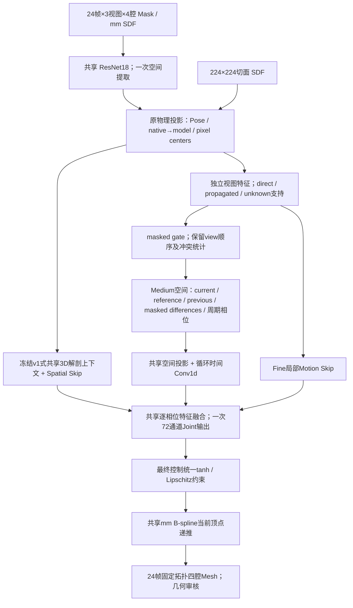

# Part I 架构与物理合同

实现为独立 `GeometryHeartFFDNetV2` / `geometry-local-temporal-joint-ffd-v2`。v1源码、配置和Checkpoint不修改。v2继承其固定几何、原 ResNet18+GroupNorm Encoder、多尺度3D U-Net及Coarse/Medium参考Head。新的局部时间条件进入一个72通道Joint Fine输出；没有自由顶点后处理，没有四个独立腔室Head。

## 维度与来源

- 输入 `[B,T=24,V=3,C=4,224,224]`；CNN空间输出 `[B,24,3,128,14,14]`、`[B,24,3,128,7,7]`。
- 共享投影宽度 `P` 在YAML显式配置。独立视图观测为 `[B,T,V,2*P+4,Gx,Gy,Gz]`；后4通道是按同一Pose采样的二维切面SDF，不是真实三维SDF。
- 物理查询使用现有control origin/spacing；Fine节点 `[24,24,32]`，Medium节点 `[12,12,16]`。Medium重新从缓存CNN图采样，不运行第二套Backbone。
- 当前P=4，view宽度12。Fusion保留3个weighted view槽、12通道冲突方差、7个支持/标注标记和1个距离标记，总计56通道；与原14通道上下文观测拼接成70通道局部条件。
- 局部时间模块保留 `[B,24,8,12,12,16]`；主要时间交互在Medium节点执行。按真实origin/spacing重采样到Fine节点，保留独立时间维。
- Fine Skip共享轻量1×1三维投影，输入保留三个视图的CNN/SDF、参考及相邻差异、交集与未知标记，输出 `[B,24,8,24,24,32]`。
- 共享3D Context `[B,32,24,24,32]`、每时相Motion和Fine Skip先融合为 `[B,24,8,24,24,32]`。最后一个ConvBlock中分组卷积**一次**输出 `[B,72,24,24,32]`；24组对应固定时间身份，每组输出XYZ。前面的逐相位投影权重共享，循环时间交互与共享上下文已读取完整周期；没有23次独立解码。
- Fine控制转为 `[B,Time=24,Gx=24,Gy=24,Gz=32,XYZ=3]`。Coarse/Medium均为共享三维参考形变。

## 坐标与支持

调用冻结的 `project_physical_points` 和 `feature_sampling_grid`，不另写Pose转换。
`q=(X_mm/norm_to_mm-t)@R`，native pixel按原Renderer `W/2,H/2` 原点；`model_to_native` 的逆得到模型像素。14/7特征中心分别是4+16*j / 8+32*j，使用align_corners=True；原224px SDF使用整数像素中心、align_corners=False。

直接支持为离面±0.75mm的离散查询容差，不声称是实际超声切片厚度；0.75…24mm为高斯特征传播区；24mm外、图像外和没有有效视图为Unknown。三个标记互斥。未标注腔室SDF和特征有效性明确置零/False，不能当背景。所有view槽保留A2C/A3C/A4C身份。

冲突统计需要至少两个支持视图；invalid视图gate权重严格0，全Unknown位置全部权重0。不同来源未先平均丢失。局部相减需当前/参考或当前/上一帧的特征有效性交集；混合特征还要求视图与标注来源一致，CNN视图特征要求该视图标注合同一致。参考与当前不重叠时差异为0，但未知标记和可用参考条件仍保留。

所有差异是固定物理节点上的Eulerian特征变化，不是对应组织点位移，也不作为Motion GT。时间Previous以roll(1)保留真实23→0边界，sin/cos显式编码24相位。

## FFD语义与安全

最终Head输出后才统一限幅和导数上界约束。继承v1每XYZ参考12mm、增量2mm、Lipschitz上界0.45；Raw非有限控制立即报错。没有独立分支直接加顶点位移。

`V0=Fine0(Medium(Coarse(template)))`；`Vt=V(t-1)+PhysicalFFD(V(t-1),Fine_t)`。只有物理应用阶段逐帧递推，源frame0不是各腔室临床ED；frame23不复制frame0。直接控制响应和累计Mesh响应在Part II分别审核。

CUDA AMP仅用于网络特征算术；Pose、物理查询、像素转换、跨物理格重采样坐标和最终FFD使用float32。其可用性须经实际GPU测试，代码存在不能视为测试已通过。

## 受控版本

A0：原G1，从零、同预算训练。A1：显式Medium局部时间条件。A2：增加按视图保留的224px SDF条件。A3：增加可学习支持gate、逐视图CNN证据和冲突统计。A4：增加Fine局部Motion Skip，构成完整v2。开关可审查、独立；最终保留组件由消融决定，不由架构复杂度决定。

## 源接合合同与审计接口

四腔是独立封闭的腔体表面，源模板封口在 LV/LA 与 RV/RA 固定支持区存在表示层面的接触/少量包含，不能套用四个完全分离球体的假设。v2 绑定不可变源支持文件和实现哈希，只允许对应房室 Face-ID 区域；远端面接触、区外包含和整体包裹均拒绝。最终组合控制后，物理支持域、导数上界、采样组合 Jacobian、实际 CGAL 三角片、VTK 腔间接触与包含、有效切面 component 分别检查；原 v1 和原生 Renderer 保持原样。逐帧审核与连续 CCD 需分别报告，不把正 Jacobian 当实际三角片检查。

零控制场落在 Lipschitz 约束不触发的内部区间，其限幅映射导数是恒等。v2 的 `bound_control_field` 只将非零场交给原 `_bound`，避开原证书 sqrt(0) 在 inactive 路径中产生 NaN 梯度；零场输出与恒等导数有实际回归测试。非零场仍调用原有 tanh 与统一缩放，没有放松物理上界。

审计脚本与训练接口独立：`audit_geometry_motion.py` 输出控制直接响应、累计 Mesh 响应、空间目标/未知区响应、32 方向有限差分子空间谱和局部分支关闭效果；32 方向的数值秩不代表完整 Decoder 秩。局部轮廓通过物理尺寸 Gaussian 窗内的像素 warp 扰动，Mask/SDF 同步重新生成；方向实验比较污染轮廓恢复至原正确观测，不要求任意污染朝 GT 改善。Oracle 从 GT frame0 起始，仅优化23个物理增量并逐步安全审核，不是 Shape Oracle，也不使用网络条件。

`slice_consistency_audit.py` 只比较相同 Mesh/Pose 的旧 binary_native_v1 与原 Exact Dice、连续切面到 GT 像素边界距离及受约束候选更新。正式训练 Loss/权重未改变。
